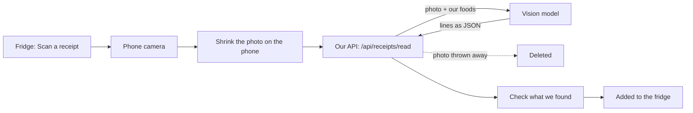
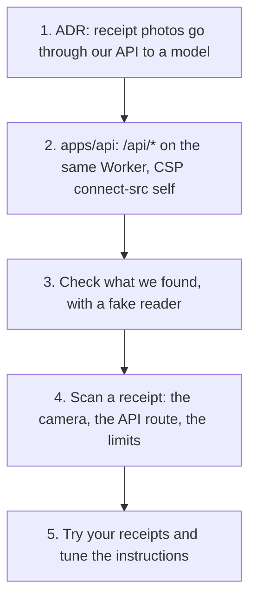

# Proposal: scan a paper receipt

- **Status:** Proposed, for Mayur to decide
- **Date:** 2026-10-15
- **Builds on:** [ADR 0025](../adr/0025-server.md) (our own API), [receipts by email](receipts-by-email.md) (#108)

## In one line

Take a photo of the shop's receipt. The app lists what you bought, you untick anything wrong, and it goes into the fridge.

## Why

- Typing what you bought is the chore that makes people stop using the app.
- Supermarkets and corner shops hand out paper receipts. Many never email one.
- One photo adds 10 to 20 things at once, with amounts and the day you bought them.

## Two ways to read a photo

| | On the phone (Tesseract) | Through our API (a vision model) |
|---|---|---|
| The photo | Never leaves the phone | Goes to our API and the model, and is thrown away after reading |
| Faded thermal paper | Often wrong | Reads well |
| "AMUL PNR 200G" → Paneer, 200 g | We'd write rules for every shop | The model does it, given our list of foods |
| Download | Several MB on the first scan | Nothing |
| Cost | $0 | About half a US cent a receipt |
| Needs | Nothing new | Only `apps/api`: no accounts, no database |

**Recommendation: through our API.** A scan that's wrong half the time gets used once and then never again.

## How it works



1. On the Fridge, "Scan a receipt" opens the camera. It's the phone's own camera, through a file picker, so there's no permission maze.
2. The phone shrinks the photo to about 1,600 pixels, which makes it faster and cheaper.
3. Our API checks the limits (see "Money"), then sends the photo to the model with our list of foods.
4. The model returns the shop, the date and, for each line, the printed text, our food (or "don't know") and the amount. Nothing else.
5. The API checks that the reply has the right shape, sends it to the phone, and forgets the photo.
6. The phone shows **Check what we found**. Nothing is added until the person says so.

## Check what we found

```
 We found 9 things at FairPrice, 14 Oct

 [x] Paneer, 200 g        AMUL PNR 200G
 [x] Spinach, 250 g       FP SPINACH 250G
 [x] Onion, 1 kg          ONION RED 1KG
 [ ] Which food is this?  MDH KSR MTHI 25G   [Match]
 ...
 Not food (3)             ▸

 [ Add 8 to my fridge ]
```

- Every line shows what was printed beside our guess, so a mistake is easy to spot.
- A line we don't know can be matched once. The phone remembers it for that shop next time.
- Non-food lines (soap, bags) are folded away.
- The day bought is the receipt's date, so "use soon" stays right.
- Anything on the shopping list that was bought gets ticked off.

This screen and the remembered matches are the same ones email receipts will use.

## Privacy, in plain words

| Goes out, for a few seconds | Kept, on the phone only | Never kept anywhere |
|---|---|---|
| The photo, to our API and the model | Shop, date, items, amounts | The photo |
| | | Names, phone numbers, card digits on the receipt |

- The model is told to return food lines only. The API drops any field it didn't ask for.
- Logs hold how many lines were read, how long it took, and what it cost. Never the content.
- Until sign-in exists, nothing about a scan is stored on our side at all.
- The model provider is Anthropic's API, whose commercial terms say API data isn't used for training by default. The ADR will link the current terms.

## Money

**Cost of one receipt:** about 1,600 tokens for the photo, about 1,500 for our foods and the instructions (cached, so cheaper), and about 600 for the reply. At Claude Haiku 4.5's prices ($1 per million tokens in, $5 out), that's **about $0.005 a receipt.** Newer models may be cheaper; I'll check the official price page in the ADR.

**At scale:** 100 families scanning twice a week is about **$4 a month.**

**There's no sign-in yet, so anyone could call it.** Three guards:

1. **Per phone:** 10 scans a day.
2. **Whole app:** a daily cap, for example $1 (about 200 scans). After that the app says "Scanning is resting until tomorrow", and typing still works.
3. **A monthly spend limit** set in the Anthropic console, as the last guard.

Once sign-in exists, scanning will need it.

## What's needed

### From you (Mayur)

1. **Approve this proposal.** It's privacy and money.
2. **An Anthropic API key,** with a monthly spend limit (say $10). Add it as a Worker secret with `wrangler secret put`. I never need to see it.
3. **Photos of 3 to 5 real receipts** from the shops you use. Black out names if you like. They become the test set. It's run by hand, not in CI, because each run costs money.

### Built by Claude, in this order (tests first, each its own PR)



- **No new dependency.** The API calls the model with plain `fetch`. The phone shrinks the photo with a canvas.
- **Size budget:** the scan screens load only when opened, so a first visit stays the same.
- **Tests never call the model.** The e2e tests use a fake reader, and a strict shape check guards the real one.
- **No Supabase needed.** This can ship before email receipts, and it's the first real use of `apps/api`.

## Risks, and what we do about them

| Risk | What we do |
|---|---|
| A blurry or crumpled photo | "Couldn't read this receipt. Try a flat, bright photo." Typing still works. |
| The model makes up an item | Nothing is added without the check screen; the printed line sits beside each guess |
| Someone burns our money | Per-phone limit, daily cap, console spend limit |
| The model service is down | "Try again later"; the rest of the app is unaffected |
| A very long receipt | One photo for now; two photos for one receipt comes later if people need it |
| Receipts in Hindi or Arabic | The model reads them; your samples will tell us how well |

## Not in this proposal

- Scanning barcodes, or a photo of the groceries themselves.
- Live camera scanning (the phone's camera app is enough).
- Prices and spending reports.
- Sharing scanned items with other phones (that comes with sign-in).

## Decision needed

**Yes / no / change:** receipt photos are read by a model through our API, then thrown away, with a check screen before anything is added. If yes, the next step is the ADR, then `apps/api`.
