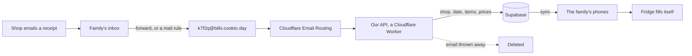
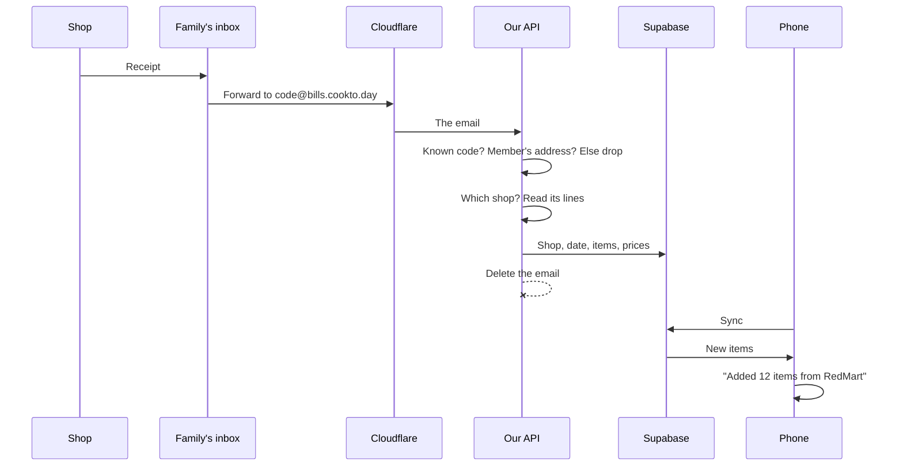
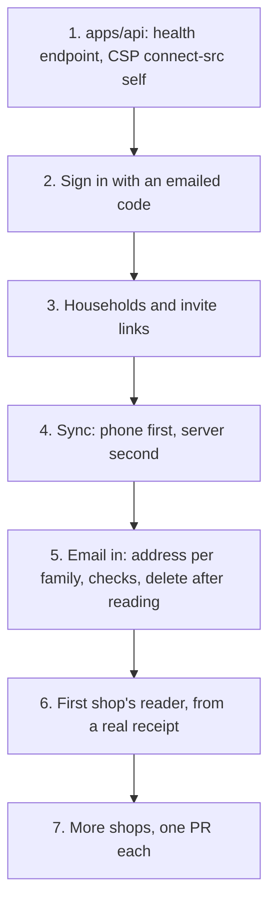

# Proposal: receipts by email

- **Status:** Proposed, for Mayur to decide
- **Date:** 2026-10-15
- **Builds on:** [ADR 0025](../adr/0025-server.md) (our own API, Supabase, bill forwarding), [ADR 0013](../adr/0013-static-browser-only.md) (privacy)

## In one line

Each family gets its own email address. They forward their grocery receipts to it, and the fridge fills itself.

## Why

- Typing what you bought is the chore that makes people stop using the app.
- Online shops (RedMart, FairPrice, pandamart, Blinkit, BigBasket) already email a receipt with every order.
- Forwarding an email takes one tap. A mail rule does it with no taps at all.

## How it works

1. The family turns on "Receipts by email" in Settings. They must sign in first: the email has to reach *their* fridge.
2. The app shows their address, such as `k7f2q@bills.cookto.day`, with a Copy button.
3. They forward a receipt, or set a mail rule once ("from RedMart → forward to …").
4. Cloudflare receives the email and hands it to our API.
5. The API checks it:
   - Is the code a real family's?
   - Is the sender one of that family's signed-in members?
   - If not, the email is dropped.
6. It reads the receipt with that shop's reader: items, amounts, prices.
7. It saves only the shop, the date, and the items with their prices. **The email itself is thrown away**, never stored.
8. Phones sync, and the Fridge shows "Added 12 items from RedMart, 14 Oct". The person can undo any line.

## What happens to one email

## Privacy, in plain words

| We keep | We never keep |
|---|---|
| Which shop, which day | The email |
| Each item, amount and price | Names, addresses, phone numbers on the receipt |
| | Card numbers or payment details |

- Logs hold the shop's name and how many lines were read, never the content.
- We never read anyone's inbox. People forward to us; we don't log in to Gmail.
- Deleting the account deletes everything within 30 days.

## What's needed

### From you (Mayur)

1. **Approve this proposal.** It's privacy and money, so it's your call.
2. **Turn on Cloudflare Email Routing** for `bills.cookto.day` on your Cloudflare account. It's free, and it adds MX records. It's a DNS change, so you do it, or approve me doing it.
3. **Create a Supabase project** in Singapore, on the free plan, and share its keys as Worker secrets.
4. **Forward me 2 or 3 real receipts** from the shops you use. Names and addresses can be blacked out. Each shop's reader is tested against a real sample.
5. **Pick an email provider** for sign-in codes (Brevo or Resend, both free to start).

### Built by Claude, in this order (each its own spec or ADR, tests first)

Steps 1 to 4 are ADR 0025's plan, already decided. This proposal adds detail to step 5 onward.

## Cost

- **Cloudflare Email Routing:** free.
- **Workers:** free plan, 100,000 requests a day. Each email takes a few milliseconds; a test fails any shop reader slower than 5 ms.
- **Supabase:** free plan, 500 MB. One receipt's lines are a few kilobytes.
- **Sign-in emails:** free tiers (Brevo: 300 a day).
- **Total to start: $0.** The first cost would be Cloudflare's $5-a-month plan, if emails ever outgrow the free one.

## Risks, and what we do about them

| Risk | What we do |
|---|---|
| A shop changes its email layout | Its reader's test fails on a new sample; the family sees "Couldn't read a RedMart email from 14 Oct" |
| Someone sends spam to an address | Only members' own addresses are accepted; anything else is dropped unread |
| An address leaks | The family can make a new one in Settings; the old one stops working |
| Gmail's "confirm forwarding" email | Shown in the app, so setting up the rule works |
| A receipt names things we don't know ("FP Fresh Spinach 250g") | Each shop's reader maps names to our ingredients; unknown lines are shown for the person to match once, and remembered |

## Not in this proposal

- Photographing paper receipts (that's reading a photo on the phone; a separate spec).
- Reading PDFs attached to emails (later, per shop).
- Prices and spending reports.

## Decision needed

**Yes / no / change:** a per-family `@bills.cookto.day` address that reads forwarded receipts and throws the email away. If yes, the next step is ADR 0025's first PR: `apps/api` with a health endpoint.
